<div align="center">



<br />

**An evolving portfolio of cloud infrastructure, automation, software engineering, and design.**

I work in **HRIS Technical Support** and build practical systems to deepen my experience with cloud computing, infrastructure, networking, and software development.

**[Explore my portfolio](https://jervilangelo.online/)** · [Projects](https://jervilangelo.online/projects) · [Certifications](https://jervilangelo.online/certifications) · [Journey](https://jervilangelo.online/journey) · [Contact](https://jervilangelo.online/contact)

<br />


</div>

---

## About this portfolio

**Building my way into the cloud** is more than a headline. This site documents what I have learned by building, testing, troubleshooting, and improving real projects.

My professional experience in technical support informs how I approach systems: understand the problem, reduce unnecessary complexity, document the solution, and make the result useful for someone else.

The portfolio brings together cloud projects, software applications, professional certifications, and creative work. It is a personal record of learning and experimentation—not a claim that every project is production-scale.

## Selected work

| Project | What it demonstrates | Repository |
| :-- | :-- | :-- |
| **[Teolohiya.site](https://teolohiya.site/)** | A Philippine theological-book listing platform; Next.js and AWS infrastructure, authentication, storage, and application deployment. | [Source](https://github.com/jervilangelo/teolohiya.site) |
| **[Opsentra](https://jervilangelo.github.io/opsentra/)** | A cloud operations and incident response platform for AWS: event-driven detection, approved and audited SSM remediation, and verified recovery, built with Terraform. | [Source](https://github.com/jervilangelo/opsentra) |
| **[BayanihanDR](https://github.com/jervilangelo/bayanihan-dr)** | A disaster recovery proof of concept using Terraform and AWS infrastructure automation. | [Source](https://github.com/jervilangelo/bayanihan-dr) |
| **[Schedrift](https://github.com/jervilangelo/schedrift)** | Presentation-ready project timelines, Gantt visualization, task dependencies, and delay simulation. | [Source](https://github.com/jervilangelo/schedrift) |
| **[PinansyalPH](https://jervilangelo.github.io/pinansyalph-v2/)** | Open-source Philippine financial literacy calculators and economic data visualizations. | [Source](https://github.com/jervilangelo/pinansyalph-v2) |
| **[ECCM Website](https://ecc-manila.org/)** | A responsive website for a local church, built as a nonprofit contribution. | [Source](https://github.com/jervilangelo/eccm-web) |

The full [Projects page](https://jervilangelo.online/projects) includes additional cloud infrastructure and HRIS-related builds.

## What this site includes

- **Projects:** case studies, technical architecture, technologies used, and lessons learned.
- **Certifications:** cloud and IT credentials with supporting verification links.
- **Journey:** a visual timeline of education, work, learning, and technical milestones.
- **Resume / CV:** professional experience and technical capabilities.
- **Services:** websites, design, and other creative work.
- **Contact:** ways to connect about technical opportunities and collaborative projects.

## Built and designed

This portfolio is a **static, multi-page site**, intentionally built without a heavyweight frontend framework.

| Area | Implementation |
| :-- | :-- |
| Structure | Semantic HTML, distinct pages for projects, certifications, journey, about, and contact |
| Design | Custom CSS, responsive grid layouts, dark UI, sage-green accents |
| Typography | Clash Grotesk, with supporting typefaces where used |
| Interaction | JavaScript-based navigation, reveal effects, transitions, and interactive visuals |
| Cloud hero | Animated cloud illustration and service nodes |
| Delivery | GitHub Pages |

The design emphasizes clear hierarchy, readable content, restrained motion, and responsive layouts.

### Design principles

**Show the work.** Projects and case studies matter more than a long list of buzzwords.

**Make the technical understandable.** Architecture and infrastructure are most valuable when their purpose is clear.

**Keep learning visible.** The site is updated as I build new projects and develop my skills.

## Run locally

Clone this repository and serve its root directory with any static HTTP server.

```bash
git clone https://github.com/jervilangelo/de-leon-portfolio.git
cd de-leon-portfolio
python -m http.server 8000
```

Open **http://localhost:8000/** in your browser.

You can also use a VS Code local static-server extension. No Node build step is required for the website itself.

## The README illustration

The animated SVG above borrows the live site's charcoal, warm white, and sage palette as well as its floating-cloud concept. It uses CSS-only motion, requires no JavaScript, and disables animation when `prefers-reduced-motion` is enabled.

The SVG is a stylized illustration, not a screenshot or official AWS logo set. Actual project technologies and implementation details are documented on the website.

## Connect

**[Visit the portfolio](https://jervilangelo.online/)** · **[GitHub](https://github.com/jervilangelo)** · **[LinkedIn](https://www.linkedin.com/in/jervilangelo/)** · **[Contact page](https://jervilangelo.online/contact)**

---

<div align="center">

**Building, learning, and documenting—one project at a time.**

</div>
